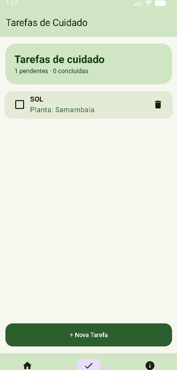
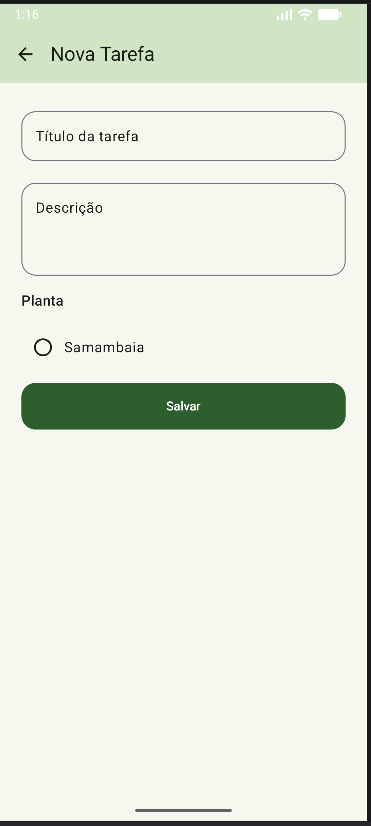
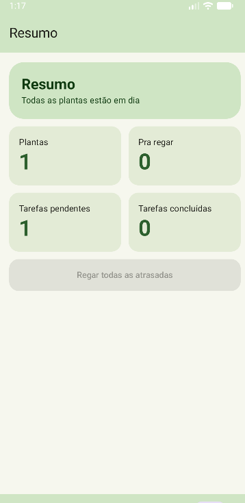
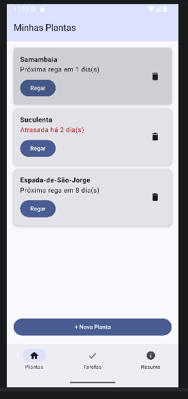
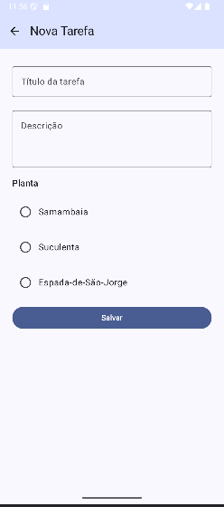
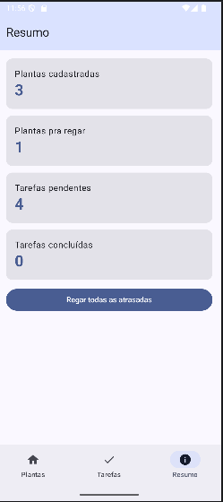
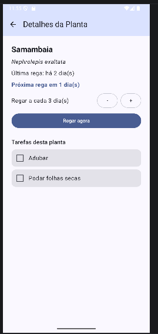

# BrotoApp

App de plantas feito em Jetpack Compose. Cadastra as plantas, mostra quando precisa regar e tem uma lista de tarefas de cuidado (adubar, podar, trocar vaso).

Trabalho 3 (Room) - continuação do Trabalho 2. Agora os dados ficam salvos no banco do aparelho (SQLite, usando o Room) e continuam lá depois de fechar o app.

Integrantes:
- Fhael Saporiti Vispo
- Bruno Burkner

## Como rodar

1. Clonar ou baixar o repositório e abrir a pasta do projeto no Android Studio. O caminho da pasta não pode ter acento nem caractere especial (por exemplo "Área de Trabalho"), senão o Gradle dá erro.
2. Esperar o Gradle sincronizar. O Room e o KSP já estão configurados nos arquivos do Gradle.
3. Rodar no emulador ou no celular. O banco é criado sozinho na primeira vez que o app abre, não precisa configurar nada.

Pra testar a persistência: cadastrar uma planta, fechar o app de verdade (tirar da lista de apps recentes), abrir de novo e ver que a planta continua lá.

Se mudar os campos de uma Entity depois de já ter rodado o app, desinstalar o app do emulador antes de rodar de novo, senão o Room reclama que o banco mudou.

## Telas

- Plantas
- Tarefas
- Resumo
- Nova Planta
- Nova Tarefa
- Detalhes da Planta
- Detalhes da Tarefa

Plantas, Tarefas e Resumo ficam na barra de baixo.

## Documentação do Trabalho 3

### Como estava o projeto no Trabalho 2 e o que mudou

No Trabalho 2 o app já tinha navegação de verdade (NavHost) e dois tipos de item, Plant e CareTask. Só que as duas listas ficavam em mutableStateListOf dentro do BrotoApp (AppNavigation.kt), e começavam sempre com 3 plantas e 4 tarefas de exemplo. Fechou o app, perdeu tudo.

Pra chegar até aqui:
- Plant e CareTask viraram @Entity e criamos o PlantDao, o CareTaskDao e o AppDatabase.
- Tiramos as listas e as funções de regar, mudar frequência e marcar tarefa de dentro do BrotoApp. Agora ele só tem a barra de cima, a barra de baixo e o NavHost.
- Cada tela busca no banco o que precisa quando abre (LaunchedEffect) e todo adicionar, editar e remover grava no banco.
- As telas de detalhe agora só recebem o id pela rota e buscam o item no banco, em vez de receber o objeto pronto.
- As plantas e tarefas de exemplo saíram, o app começa vazio.
- Também melhoramos o visual (explicado mais abaixo).

### Como criamos Entity, DAO e Database

**Entities**
- `Plant` (tabela `plantas`): name, species, wateringFrequencyDays e daysSinceWatered. Ficaram os mesmos campos do Trabalho 2, porque são eles que o app usa pra calcular a próxima rega.
- `CareTask` (tabela `tarefas`): title, description, plantId e done. O plantId guarda de qual planta é a tarefa, é assim que as duas tabelas se ligam. O done é o que a checkbox marca.
- As duas têm `@PrimaryKey(autoGenerate = true) val id: Int = 0`. Com isso o Room gera o id sozinho e não precisamos mais dos contadores proximoIdPlanta e proximoIdTarefa que existiam no BrotoApp.

**DAOs** (`PlantDao` e `CareTaskDao`): cada um tem os 4 básicos, todos `suspend`: `inserir` (@Insert), `buscarTodos` (@Query), `atualizar` (@Update) e `deletar` (@Delete).

**AppDatabase**: classe abstrata que estende RoomDatabase, com as duas entities, `version = 1` e os dois DAOs. Usa o padrão Singleton visto em aula (companion object com @Volatile e synchronized), então o app inteiro usa o mesmo banco.

### Queries além dos 4 básicos

- `PlantDao.buscarPorId(id)`: usada na tela de detalhes da planta.
- `CareTaskDao.buscarPorId(id)`: usada na tela de detalhes da tarefa.
- `CareTaskDao.buscarPorPlanta(plantId)`: mostra as tarefas daquela planta no detalhe da planta.
- `CareTaskDao.deletarPorPlanta(plantId)`: quando a planta é removida, as tarefas dela vão junto. No Trabalho 2 isso era um removeAll na lista.

### Dificuldade de migrar do mutableStateListOf pro Room

- Com a lista em memória, o BrotoApp era o dono dos dados e passava pras telas. Com o Room o dono é o banco, então tivemos que tirar as listas de lá e deixar cada tela buscar o que precisa quando abre.
- Todas as chamadas ao DAO ficam dentro de `CoroutineScope(Dispatchers.IO).launch`, pra tela não travar. Depois de cada inserir, atualizar ou deletar a tela busca a lista de novo, pra mostrar o que ficou no banco.
- No adicionar, se a tela voltava pra lista logo depois de mandar salvar, a lista podia abrir antes da planta chegar no banco e aparecer sem ela. Resolvemos fazendo o `popBackStack` só depois do `inserir` terminar (voltando pra thread principal com `withContext(Dispatchers.Main)`), e deixando o botão Salvar desligado enquanto salva.
- No Gradle, o plugin do KSP precisa estar configurado antes de usar a linha `ksp(...)` do Room, senão o Gradle não reconhece.

### Visual

Depois que o Room estava funcionando, a gente quis deixar o app mais bonito, porque o visual do Trabalho 2 estava muito básico. Isso deu mais trabalho do que parecia:
- O tema tinha a paleta verde, mas no emulador o app aparecia com outras cores. O motivo era o `dynamicColor`, que no Android 12 pra cima usa as cores do sistema e ignora a nossa paleta. Desligamos ele e completamos a paleta nos temas claro e escuro.
- Só trocar a cor não resolveu, o app continuava parecendo uma lista simples. Então mudamos o layout: cabeçalho colorido em cada tela de lista, avatar com a inicial do nome da planta, cards arredondados, botões maiores e a tela de Resumo em grade com cards lado a lado.
- Como isso se repete em várias telas, juntamos o avatar, o cabeçalho e as formas arredondadas no arquivo `Componentes.kt`, pra não copiar o mesmo código em cada tela.
- Tudo foi feito só com o que vimos em aula (Surface, Card, Row, Column, Spacer, Modifier e MaterialTheme).

Telas depois das mudanças (todas lendo do banco):

  

### Teste de persistência

TODO: colocar aqui o vídeo (ou prints em sequência) mostrando: adicionar um item, fechar o app de verdade, abrir de novo e o item continuar lá.

### Dificuldades do trio

- A parte que mais deu trabalho foi o visual, porque queríamos que o app ficasse bonito sem usar nada que não foi visto em aula. Fomos testando no emulador e ajustando até chegar no resultado.
- Na hora de rodar o projeto deu erro no Gradle porque o caminho da pasta tinha um acento ("Área de Trabalho"). Resolvemos movendo o projeto pra uma pasta sem acento.
- Também tivemos que ajustar as telas, porque elas dependiam das listas que estavam no BrotoApp. Cada uma precisou passar a buscar os próprios dados no banco.

## Documentação do Trabalho 2

No Trabalho 1 o app tinha 3 telas (lista de plantas, detalhe e adicionar planta). A troca de tela era feita por uma variável de texto no MainActivity, só tinha um tipo de item (Plant) e a lista começava com 3 plantas fixas.

Pra chegar no Trabalho 2 trocamos essa variável por NavHost com NavController, então a navegação ficou de verdade e o detalhe recebe o id da planta pela rota. Também criamos um segundo tipo de item (CareTask), mais 4 telas, a barra de baixo e a barra de cima com o botão de voltar. Nas 3 telas antigas, o botão de voltar e o título foram pra barra de cima.

Também mudamos o Plant: o lastWatered (texto com a data) virou daysSinceWatered (número de dias desde a última rega), pra dar pra calcular quando é a próxima rega. E a lista de plantas ganhou um botão de remover.

Lista de plantas e cadastro de planta:

 

Criamos as telas de tarefas porque cuidar de planta não é só regar. Cada tarefa é ligada a uma planta. A tela de resumo mostra os números gerais e deixa regar todas as atrasadas de uma vez.

  

As rotas ficam no objeto Rotas e o NavHost no AppNavigation.kt.

No detalhe da planta calcula a próxima rega, dá pra mudar a frequência ali mesmo e mostra as tarefas daquela planta. Escolhemos isso porque a frequência de rega é o dado principal da planta.

O detalhe da tarefa mostra a planta ligada a ela, com um botão pra abrir o detalhe da planta.

Dificuldades: na hora de rodar o projeto no Android Studio deu uns 60 erros de "Unresolved reference" (icons e navigation). Faltavam as dependências do navigation-compose e do material-icons, e na primeira tentativa colocamos as linhas dentro do bloco android {} do build.gradle.kts, por isso continuava vermelho. Resolvemos movendo as duas linhas pro bloco dependencies {} e sincronizando o Gradle.
